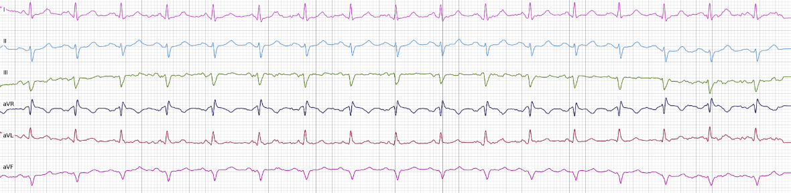
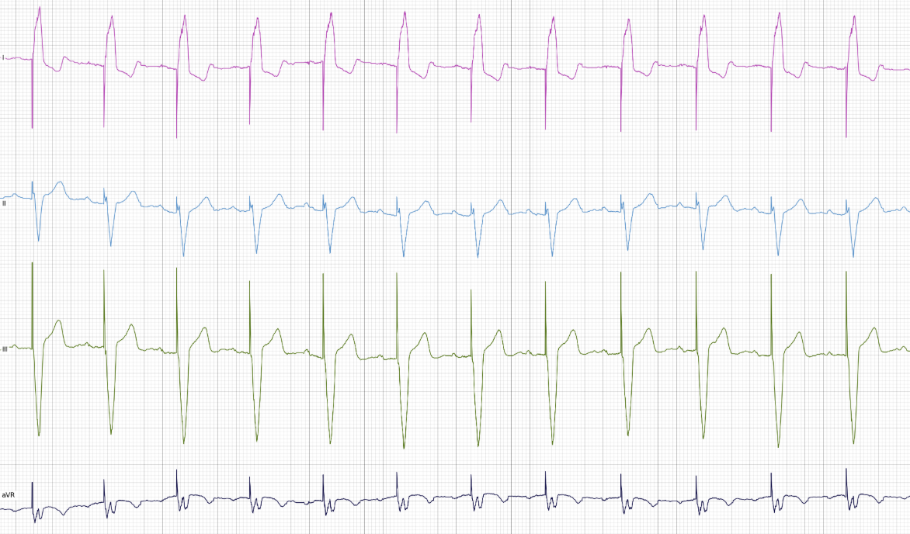

# Классификация ЭКГ с кардиостимулятором

Бинарная классификация сигналов ЭКГ (12 каналов, 500 Гц, 10 секунд) на два класса:
**NOECS** — стандартная ЭКГ и **ECS** — ЭКГ с электрокардиостимулятором.
В основе — нейросеть Xception1D, гиперпараметры которой подбираются автоматическим
оптимизатором (Globalizer).

---

## Содержание

- [Зачем это нужно](#зачем-это-нужно)
- [Почему не справятся аналитические методы](#почему-не-справятся-аналитические-методы)
- [Примеры сигналов](#примеры-сигналов)
- [Как устроен скрипт](#как-устроен-скрипт)
- [Гипероптимизация](#гипероптимизация)
- [Структура репозитория](#структура-репозитория)
- [Запуск](#запуск)
- [Требования](#требования)

---

## Зачем это нужно

Автоматическое распознавание наличия ЭКС в записи ЭКГ — практически значимая задача:

- **Безопасность диагностики.** Спайки стимуляции и изменённая морфология комплексов QRS
  у пациентов с ЭКС могут имитировать инфаркт, ишемию, блокады или нарушения ритма.
  Без учёта стимулятора высок риск ложноположительных диагнозов.
- **Корректная интерпретация автоматических анализаторов.** Большинство коммерческих
  алгоритмов ЭКГ-анализа откалиброваны на «нативных» сигналах и часто ошибаются на
  записях с ЭКС. Явное указание «есть ЭКС» позволяет переключить пайплайн на
  специализированные правила или пометить заключение как требующее особого внимания.
- **Сортировка и маршрутизация данных.** В крупных базах холтеровского мониторирования
  и телемедицинских сервисах — сотни тысяч записей. Автоматическое отделение записей
  с ЭКС позволяет направлять их на отдельные протоколы анализа и формировать
  стратифицированные выборки.
- **Мониторинг пациентов с имплантированными устройствами.** Важно отслеживать не
  только ритм, но и корректность работы самого устройства (наличие/отсутствие
  стимуляции, захват, сенсинг). Определение того, что запись содержит стимулированные
  комплексы, — первый шаг к такому мониторингу.
- **Качество датасетов.** При сборке обучающих корпусов необходимо помечать записи
  с ЭКС, иначе модель, обученная на смешанных данных, будет нестабильна и плохо
  обобщаема.

---

## Почему не справятся аналитические методы

Попытки решить задачу пороговой детекцией спайков по амплитуде или производной
на практике ненадёжны:

1. **Вариабельность морфологии спайка.** Спайк — короткий (единицы мс)
   высокочастотный импульс, но его амплитуда, полярность и форма зависят от типа
   устройства, режима стимуляции, положения электродов, фильтров аппаратуры и
   отведения. В одном отведении спайк ярко выражен, в другом — почти неразличим.

2. **Перекрытие спайка с собственными комплексами.** Стимуляция часто происходит
   на фоне уже присутствующей электрической активности. Спайк «накладывается»
   на QRS или T-зубец, и пороговая детекция либо пропускает его, либо ложно
   срабатывает на крутых фронтах нормального QRS.

3. **Артефакты и шумы.** Мышечный тремор, движение электродов, сетевые наводки
   50/60 Гц, артефакты контакта дают высокочастотные выбросы, неотличимые от
   спайков по простым признакам. Детекторы спайков в реальных условиях дают много
   ложных срабатываний.

4. **Стимуляция не всегда видна как «спайк».** При бивентрикулярной стимуляции,
   малой амплитуде импульса, современных устройствах с изменяемой формой импульса,
   а также после агрессивной фильтрации (например, ФНЧ 40 Гц) спайк сглаживается
   до почти неразличимого уровня. Порогового события нет, но комплекс всё равно
   стимулированный.

5. **Стимулированные комплексы ≠ только спайки.** Даже если спайк обнаружен, нужно
   корректно интерпретировать следующий за ним комплекс: захвачен ли он, есть ли
   сенсинг, не псевдоспайк ли это. Это требует анализа контекста — формы QRS,
   интервалов, соотношения с предыдущими комплексами. Правиловые методы быстро
   разрастаются в хрупкие эвристики.

6. **Индивидуальная и популяционная вариабельность.** Нормальная ЭКГ крайне
   вариабельна (возраст, конституция, положение сердца, сопутствующие изменения).
   Жёсткие пороги, настроенные на одну популяцию, не переносятся на другую.

7. **Многоканальность.** Информация распределена по 12 отведениям: в одном спайк
   виден, в другом — нет; в одном стимуляция выглядит положительным импульсом,
   в другом — отрицательным. Аналитический метод должен агрегировать разнородные
   признаки по каналам, что плохо формализуется пороговыми правилами.

Именно поэтому используется обучаемая свёрточная нейросеть: она учится извлекать
иерархию признаков (от локальных высокочастотных паттернов до формы комплексов
и их последовательности) непосредственно из данных, устойчиво к шумам
и вариабельности морфологии.

---

## Примеры сигналов

### Нормальная ЭКГ (без ЭКС)



*Стандартная ЭКГ: регулярные комплексы P–QRS–T с характерной для нормального
синусового ритма морфологией.*

### ЭКГ с электрокардиостимулятором



*ЭКГ пациента с ЭКС: перед комплексом QRS видны артефакты стимуляции (спайки),
морфология стимулированных комплексов отличается от нативной, возможны широкие
деформированные QRS.*

---

## Как устроен скрипт

Скрипт `PacemakerClassificationProblem.py` реализует паттерн:
класс `PacemakerClassificationProblem` наследуется от `Problem` и реализует методы
`calculate` (обучение модели и возврат метрики) и `finalize` (финальная проверка
лучшей модели на тестовой выборке). Внешний оптимизатор (`GlobalizerProblem`)
работает с этим классом как с чёрным ящиком.

### Данные и подготовка

- Датасет `dataset/ECGPacemakerClassification` разбит на `train` / `val` / `test`.
- Нормализация — **z-score** по каждому сигналу; дифференцирование не используется;
  длина сигнала приводится к **5000 отсчётам** (~10 с при 500 Гц).
- Для тренировочной выборки включена **аугментация**.
- Дисбаланс классов компенсируется через `WeightedRandomSampler` с весами,
  обратно пропорциональными частотам классов.
- `batch_size = 128`, `num_workers = 0`, `pin_memory = True`.

### Модель

- Архитектура — **Xception1D** с параметрами: `input_channels=12`,
  `use_batch_norm=True`, `use_se=False`.
- Оптимизатор — **AdamW** (`lr`, `weight_decay` — гиперпараметры).
- Функция потерь — **WeightedFocalLoss** с весами классов, `alpha`, `gamma`,
  `beta=0.999`.
- Планировщик — **ReduceLROnPlateau** (`mode='min'`, `patience=20`, `factor=0.5`).
- Обучение — до **100 эпох**, early stopping с `patience=20`.
- Метрика отбора — **F1-macro** на валидации (возвращается со знаком минус,
  так как оптимизатор минимизирует).

### Устройство (GPU/CPU)

Скрипт определяет число доступных GPU и привязывает процесс к
`cuda:{ProcRank % GPU_count}` — это позволяет параллельно запускать несколько
процессов оптимизации на разных GPU. При отсутствии GPU используется CPU.

### Сохранение моделей

После обучения модель сохраняется в `models/` в виде пары файлов:

- `{metric}.pth` — веса;
- `{metric}.json` — гиперпараметры (`num_blocks`, `growth_rate`, `kernel_size`,
  `dropout`).

Перед сохранением скрипт проверяет уже существующие чекпоинты: если в папке
есть модель с метрикой лучше текущей, новая не сохраняется. Это даёт «элитизм» —
в `models/` накапливаются только лучшие решения.

### Финализация

`finalize(coordinate, discreteCoordinate)`:

1. По переданной точке восстанавливает гиперпараметры.
2. Ищет в `models/*.json` файл, поля `num_blocks`, `growth_rate`, `kernel_size`,
   `dropout` которого совпадают с точкой (`match_by_fields`).
3. Загружает соответствующую `.pth`-модель, переводит в `eval`.
4. Прогоняет **тестовую** выборку и считает **F1-macro** — это и есть итоговая
   оценка качества.

---

## Гипероптимизация

Оптимизируются **8 параметров**:

| Параметр        | Границы          | Тип   | Смысл                   |
|-----------------|------------------|-------|-------------------------|
| `num_blocks`    | [2, 4]           | int   | число блоков Xception1D |
| `growth_rate`   | [16, 64]         | int   | скорость роста каналов  |
| `dropout`       | [0.2, 0.7]       | float | вероятность dropout     |
| `learning_rate` | [0.0001, 0.002]  | float | скорость обучения AdamW |
| `weight_decay`  | [0.00005, 0.001] | float | L2-регуляризация        |
| `loss_alpha`    | [0.5, 0.9]       | float | α в Weighted Focal Loss |
| `loss_gamma`    | [1.0, 5.0]       | float | γ в Weighted Focal Loss |
| `kernel_size`   | [3, 9]           | int   | размер ядра свёртки     |

### Цикл оптимизации

1. Оптимизатор предлагает точку `point.float_variables` в 8-мерном пространстве.
2. `calculate` приводит целочисленные параметры (`num_blocks`, `growth_rate`,
   `kernel_size`) к `int`, собирает `model_params`, создаёт модель, оптимизатор,
   лосс и планировщик.
3. Модель обучается на train, контролируется на val; возвращается
   `best_target_metric` (F1-macro).
4. Значение функции — `-best_target_metric` (оптимизатор минимизирует).
5. Модель сохраняется, если она лучше уже имеющихся в `models/`.
6. По завершении поиска `finalize` берёт лучшую точку, находит соответствующий
   чекпоинт и считает финальную метрику на **тестовой** выборке.

### Воспроизводимость и параллелизм

- Фиксированы сиды: `torch.manual_seed(42)`, `np.random.seed(42)`.
- `ProcRank` определяет GPU, что позволяет запускать несколько процессов
  оптимизации одновременно.
- Каждое обучение пишет в `./xception` (создаётся автоматически), а лучшие
  модели — в `models/`.

---

## Структура репозитория

```
.
├── PacemakerClassificationProblem.py   # задача оптимизации (обучение + финализация)
├── PacemakerScripts/
│   ├── Dataset.py                      # SignalDataset, загрузка и аугментация
│   ├── Model.py                        # Xception1D, WeightedFocalLoss
│   ├── MetricsCalculator.py            # метрики (F1-macro и др.)
│   └── Trainer.py                      # цикл обучения, early stopping, планировщик
├── dataset/
│   └── ECGPacemakerClassification/
│       ├── train/
│       ├── val/
│       └── test/
├── images/
│   ├── NormECG.PNG
│   └── PacemakerExample.PNG
├── models/                             # чекпоинты: {metric}.pth + {metric}.json
└── README.md
```

---

## Запуск

```bash
python PacemakerClassificationProblem.py
```

В `__main__` демонстрируется запуск на одной точке:

```python
pacemakerProblem = PacemakerClassificationProblem()
problem = GlobalizerProblem(pacemakerProblem)
result = problem.calculate([2, 16, 0.2, 0.0001, 0.00005, 0.5, 1.0, 3], [])
problem.finalize([2, 16, 0.2, 0.0001, 0.00005, 0.5, 1.0, 3], [])
```

Для полноценной гипероптимизации вместо одной точки следует передать
`PacemakerClassificationProblem` внешнему драйверу Globalizer, который будет
генерировать последовательность точек в заданных границах.

---

## Требования

- Python 3.12+
- PyTorch (с поддержкой CUDA — опционально)
- NumPy
- scikit-learn (`f1_score`)
- Внешние модули `trial`, `problem`, `Globalizer_problem`

Установка базовых зависимостей:

---